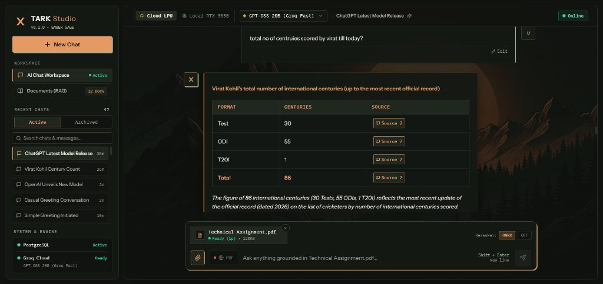
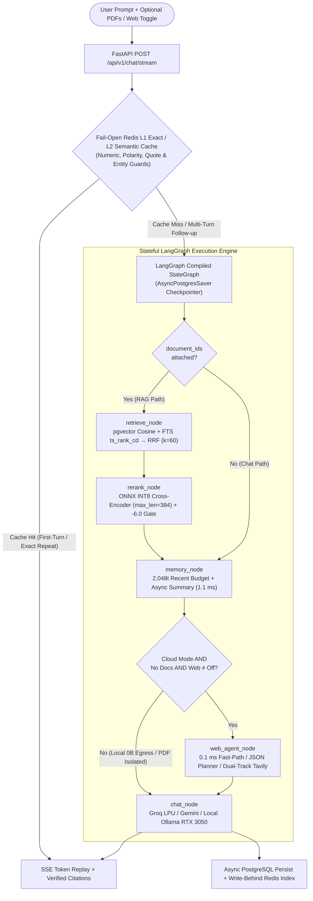

<div align="center">

<h1>TARK Studio</h1>

<p>
  <strong>Hybrid RAG, Intent-Routed Web Intelligence &amp; Sovereign Dual-Engine AI Workspace</strong>
</p>

<p>
  <a href="https://tark-studio.pages.dev/">
    
  </a>
  
  
  
</p>

<p>
  <a href="#-why-tark-studio">Overview</a> •
  <a href="#-workspace-showcase">Live UI</a> •
  <a href="#-system-architecture">Architecture</a> •
  <a href="#-technology-stack">Tech Stack</a> •
  <a href="#-audited-evaluation--benchmarks">Benchmarks</a> •
  <a href="#-quick-start">Quick Start</a> •
  <a href="#-documentation--audit-archive">Reports</a>
</p>

<br />

<a href="https://tark-studio.pages.dev/" id="-workspace-showcase">
  
</a>

<sub><em>Live production UI at <a href="https://tark-studio.pages.dev/"><code>tark-studio.pages.dev</code></a> — Dual-engine runtime toggle, grounded citation badges, PDF ONNX reranker selector, and Ember Sage visual identity.</em></sub>

</div>

---

## ⚡ At-a-Glance Performance Highlights

| **94.29%** | **1.000 / 0.980** | **-35.0%** | **74.7% – 84%** | **0 Bytes** |
| :---: | :---: | :---: | :---: | :---: |
| **Factual Accuracy** | **MRR@5 / nDCG@5** | **CPU Rerank Speedup** | **Multi-Turn Token Cut** | **Local Mode Egress** |
| `0.00%` false refusals & `4.76%` hallucination across 42 blind queries | `100%` Hit@5 with Hybrid RRF + ONNX Cross-Encoder | `1,530.1 ms → 994.7 ms` via `max_length=384` + dynamic padding | Bounded prompts (`3.6k–4.0k` tokens) with `1.1 ms` memory overhead | Air-gapped RTX 3050 CUDA (`3,688 / 4,096 MB` VRAM, 0 OOM) |

---

## 🎯 Why TARK Studio?

Most LLM applications fail under real constraints because they wrap a single cloud endpoint around naive vector search. **TARK Studio** (*Tark* — Sanskrit for *structured logic and reasoning*) is engineered as a production-grade **LangGraph state machine** designed around latency, token cost, factual auditability, and local data sovereignty:

| Production Bottleneck | Naive RAG Wrapper | **TARK Studio Implementation** |
| :--- | :--- | :--- |
| **Data Privacy & Cloud Cost** | Always sends sensitive PDFs to cloud APIs | **Runtime Hardware Toggle:** Switch instantly between **Local Sovereign Mode** (RTX 3050 CUDA via Ollama, `0B` egress) and **Cloud LPU** (Groq/Gemini), including a Chrome LNA loopback bridge from Cloudflare Pages to `127.0.0.1:8000` |
| **Retrieval Precision** | Dense-only search misses exact IDs/terms; giant rerankers OOM | **2-Stage Hybrid Retrieval + INT8 ONNX:** Concurrent `pgvector` cosine + adaptive PostgreSQL FTS (`websearch_to_tsquery` / `plainto_tsquery`), fused via RRF ($k=60$) and scored by 22.4 MB INT8 ONNX |
| **Semantic Cache Traps** | Fuzzy vector caching wrongly reuses `"2023"` answers for `"2024"` | **Entity-Guarded 2-Tier Redis Cache:** L1 exact SHA-256 + L2 float32 NumPy cosine with `passes_structural_guard()` blocking numeric, ordinal, polarity (`not`), quote, and entity mismatches—plus `O(1)` corpus version invalidation |
| **Multi-Turn Token Bloat** | Unbounded history explodes prompts (`>22k` tokens) & causes 429s | **Non-Blocking Tiered Memory:** `BackgroundSummaryManager` updates PostgreSQL LangGraph checkpoints via per-thread locks in `1.1 ms` critical-path overhead, keeping prompts bounded at `~3.6k–4.0k` tokens |
| **External Rate Limits & Drift** | Silent SDK sleeps hang the UI; web results poison local PDFs | **Explicit Quota + Isolated Routing:** `AsyncGroq(max_retries=0)` + Redis multi-worker 429 sync; structured JSON web intent router with strict isolation from PDF RAG and Local Sovereign Mode |

---

## 🧠 Core Engineering Pillars

### 1. 2-Stage Hybrid Retrieval & CPU-Safe ONNX Cross-Encoder
* **Implementation:** [`retriever.py`](backend/app/rag/retriever.py) • [`reranker.py`](backend/app/rag/reranker.py)
* **Adaptive Lexical + Dense Fusion:** Queries `pgvector` cosine similarity (`<=>`, 768-d) concurrently with PostgreSQL `ts_rank_cd` (selecting `websearch_to_tsquery` for short entity queries `≤4` tokens and conjunctive `plainto_tsquery` for long questions) and merges candidates via **Reciprocal Rank Fusion ($k=60$)**.
* **Data-Driven Rejection of OR-FTS:** Benchmark sweeps showed disjunctive `OR` full-text queries collapsed `Hit@5` from **97.5% → 62.5%**; strict conjunctive matching was enforced instead.
* **INT8 ONNX Tuning & Honest Refusals:** `Xenova/ms-marco-MiniLM-L-6-v2` (22.4 MB INT8 ONNX, ~487–507 MB steady RSS on CPU) avoids OOM crashes in 1 GB cloud containers. Dynamic batch padding at `max_length=384` cuts CPU rerank latency **35.0% (`1,530.1 ms → 994.7 ms`)**. Off-topic queries hit a `-6.0` relevance gate and emit `0` citations, while `_is_broad_document_query()` preserves document-overview queries.

### 2. Multimodal Document & Sub-0.5s Scanned PDF Ingestion
* **Implementation:** [`parser.py`](backend/app/rag/parser.py) • [`vision.py`](backend/app/rag/vision.py) • [`chunker.py`](backend/app/rag/chunker.py)
* Safely parses `.pdf`, `.md`, `.txt`, `.py` (static AST—zero code execution), and `.json` up to **100 MB** into **500-token chunks (80-token overlap)** via `tiktoken`, tracking both physical `viewer_page` and printed `book_page` (Arabic/Roman) for interactive citations.
* **Dual-Stage Scanned OCR:** Image-only PDF pages trigger **Local Tesseract OCR** first (offline, `<0.5s`/page) with automatic fallback to **Cloudflare Workers AI Llama-3.2 Vision** (`@cf/meta/llama-3.2-11b-vision-instruct`).

### 3. Intent-Routed Agentic Web Search (`Auto` / `On` / `Off`)
* **Implementation:** [`intent.py`](backend/app/ai/intent.py) • [`web_search.py`](backend/app/tools/web_search.py) • [`graph.py`](backend/app/ai/graph.py)
* **Zero-Latency Fast-Path (`0.1 ms`):** Regex screening skips LLM intent calls for greetings, stack traces, code snippets, and pure math.
* **Zero-Hardcoding JSON Planner:** Classifies live information need (`general` | `news` | `finance`), resolves multi-turn pronouns, anchors recency with current `Month YYYY`, and nominates 2–4 authoritative `target_domains`.
* **Dual-Track Search + Hygiene:** Executes parallel open-web + targeted-domain Tavily search, canonicalizes URLs (stripping `utm_*`, `msockid`, `fbclid`), blocks login-walled social noise, sanitizes prompt-injection tags inside `<untrusted_web_context>`, and ranks results in **<1 ms**. Strictly disabled when PDFs are attached or Local Sovereign Mode is active.

### 4. Fail-Open 2-Tier Redis Semantic Cache & Distributed Rate Limiter
* **Implementation:** [`cache.py`](backend/app/rag/cache.py) • [`rate_limiter.py`](backend/app/ai/rate_limiter.py)
* **L1 & Shared Embedding Cache:** Normalized SHA-256 answer cache (`tark:ans:*`) scoped by `(corpus_version, provider, model, reranker, temperature, document_ids)` plus compact `struct.pack('<Nf')` float32 embedding cache (`tark:emb:*`).
* **L2 Structural-Guarded Paraphrase Cache:** Vector similarity matching (`threshold=0.90`, bounded bucket LRU) paired with deterministic `passes_structural_guard()` checks across numbers, ordinals, negation parity, proper nouns/acronyms, and quoted spans.
* **O(1) Corpus Invalidation & Resilience:** Document upload/delete calls atomic `INCR tark:corpus:v` (`0` scan overhead). Redis errors trip a 10s circuit breaker (`0.25s` timeout) and fail open transparently, while `groq_rate_limiter` synchronizes 429 cooldowns across workers and streams live `rate_limit` UI banners.

### 5. Non-Blocking Conversation Memory & Persistent Checkpointing
* **Implementation:** [`memory.py`](backend/app/ai/memory.py) • [`graph.py`](backend/app/ai/graph.py)
* Powered by LangGraph `AsyncPostgresSaver` (`psycopg_pool`). Maintains a **2,048-token** recent verbatim buffer while `BackgroundSummaryManager` summarizes older turns asynchronously behind per-thread `asyncio.Lock` guards and syncs state back via `aupdate_state()`.

---

## 🗺 System Architecture



---

## 🛠 Technology Stack

<div align="center">

<p>
  
  
  
  
  
  
  
  
  
  
  
  
  
</p>

</div>

| Layer | Technologies | Responsibility in TARK Studio |
| :--- | :--- | :--- |
| **AI & Orchestration** | `LangGraph 0.2+`, `AsyncPostgresSaver`, `Groq`, `Google GenAI`, `Ollama`, `Tavily` | Multi-node conditional state graph, intent-routed web search, rolling memory sync, unified provider streaming (`openai/gpt-oss-120b/20b`, `qwen/qwen3.8-27b`, `llama-3.3-70b-versatile`, local `llama3.2` & `qwen2.5`) |
| **Retrieval & Inference** | `pgvector`, PostgreSQL FTS, `ONNX Runtime`, `PyMuPDF`, `Tesseract OCR`, Cloudflare Workers AI | Dual dense/sparse retrieval fused via RRF ($k=60$), INT8 cross-encoder scoring, multimodal PDF parsing, offline OCR + Vision fallback, `nomic-embed-text` / `@cf/baai/bge-base-en-v1.5` embeddings |
| **Backend & Caching** | `Python 3.12`, `FastAPI`, `Pydantic v2`, `SQLAlchemy 2.0 (asyncpg)`, `Alembic`, `Redis 7 (hiredis)` | Async REST + SSE streaming (`chat.py`, `documents.py`), Alembic migrations (`0001`–`0005`), fail-open L1/L2 semantic cache, multi-worker 429 token-bucket coordinator |
| **Frontend & UI** | `React 18.3`, `TypeScript 5.6`, `Vite 5.4`, `Tailwind CSS 3.4`, `react-markdown`, `PrismJS` | Ember Sage responsive UI, custom SVG hardware switcher, interactive `CitationDrawer`, 3-tier telemetry pills, `AbortController` stream cancellation |
| **Quality & Infra** | `Pytest`, `Vitest`, `Docker Compose`, `Caddy 2`, Cloudflare Pages | 94 collected backend tests, Vitest UI tests, multi-arch `Dockerfile`, DuckDNS + Caddy zero-buffering SSE config (`flush_interval -1`) |

<details>
<summary><strong>🎨 Ember Sage Design Tokens & Repository Structure (Click to expand)</strong></summary>

#### Color System (70 / 20 / 10 Industrial Hierarchy)
* **Canvas & Surfaces:** Main `#10130F` • Sidebar `#171C17` • Elevated `#20271F` • Borders `#394336`
* **Typography & Accents:** Primary `#F1EEE6` • Secondary `#B7BDAE` • Muted `#929B89` • Sage Accent `#A5B49A` • Ember Copper `#E59A64` (Hover `#F0AB78`)

```text
tark-studio/
├── backend/
│   ├── app/
│   │   ├── main.py              # FastAPI app, startup warmups (ONNX/LangGraph/Redis), Chrome LNA CORS
│   │   ├── config.py            # Pydantic BaseSettings (.env config & asyncpg SSL handling)
│   │   ├── database.py          # SQLAlchemy 2.0 async models (Conversation, Message, Document, DocumentChunk)
│   │   ├── ai/                  # graph.py, intent.py, memory.py, providers.py, rate_limiter.py, state.py
│   │   ├── rag/                 # retriever.py, reranker.py, cache.py, parser.py, vision.py, chunker.py, embeddings.py
│   │   ├── tools/               # web_search.py (Dual-Track Tavily + canonical dedup + <1ms ranker)
│   │   └── api/                 # chat.py, documents.py
│   ├── alembic/versions/        # Schema migrations (0001_initial_extensions → 0005_add_citations_to_messages)
│   ├── eval/                    # Blind 42-query evaluation harness (run_safe_blind_evaluation.py)
│   └── tests/                   # 94 collected tests across 15 Pytest suites
├── frontend/
│   └── src/                     # App.tsx, App.test.ts, MarkdownRenderer.tsx, CitationDrawer.tsx
├── deploy/Caddyfile             # Zero-buffering SSE reverse proxy
├── docker-compose.yml           # Local PostgreSQL 16 (pgvector) + Redis 7
├── docker-compose.prod.yml      # Full production compose (DB + Ollama + Redis + FastAPI + Caddy 2)
└── docs/                        # Architecture specs, API contracts, DB design, and empirical eval reports
```

</details>

---

## 📊 Audited Evaluation & Benchmarks

Every benchmark metric below is backed by reproducible evaluation harnesses and raw telemetry inside [`docs/reports/`](docs/reports/).

### 1. Blind 42-Query Multi-Corpus Eval (Local Sovereign Mode — RTX 3050 4 GB)
*Evaluated with [`run_safe_blind_evaluation.py`](backend/eval/run_safe_blind_evaluation.py) across 5 PDF corpora (`llama3.2:3b` Q4_K_M, `nomic-embed-text` 768-d, `BAAI/bge-reranker-base` ONNX, 0 cloud calls) — raw JSON/CSV in [`eval_42_blind_results.json`](docs/reports/eval_42_blind_results.json) & [`TARK_RAG_Evaluation_Report.md`](docs/reports/TARK_RAG_Evaluation_Report.md).*

| Grounding & Faithfulness | Score | Latency & Hardware Profile (RTX 3050 4 GB) | Value |
| :--- | :---: | :--- | :---: |
| **Factual Answer Accuracy** | **94.29% (33/35)** | **P50 E2E Response Latency** | **4.66 s** *(mean 6.46 s)* |
| **Overall Blind Accuracy** | **90.48% (38/42)** | **P50 Time-to-First-Token (TTFT)** | **1,499.8 ms** |
| **False Refusal Rate (FRR)** | **0.00% (0/35)** | **Generation Throughput** | **45.9 median / 38.8 mean TPS** |
| **Hallucination Rate** | **4.76% (2/42)** | **Peak GPU VRAM (4,096 MB Cap)** | **3,688 MB** *(408 MB headroom, 0 OOM)* |
| **Document / Page Attribution** | **100.0% / 91.43%** | **Completion Reliability** | **42/42 (100%, 0 timeouts)** |

**Retrieval Strategy Ablation (10 Multi-Corpus Queries):**

| Retrieval Configuration | Hit@1 | Hit@5 | Recall@5 | MRR@5 | nDCG@5 | Mean Latency |
| :--- | :---: | :---: | :---: | :---: | :---: | :---: |
| Sparse Only (PostgreSQL FTS) | 0.400 | 0.400 | 0.400 | 0.400 | 0.400 | **13.3 ms** |
| Dense Only (`nomic-embed-text` 768-d) | 0.500 | 0.900 | 0.844 | 0.710 | 0.746 | 661.4 ms |
| Hybrid RRF ($k=60$) | 0.600 | 0.900 | 0.844 | 0.760 | 0.796 | 344.4 ms |
| **Hybrid RRF + ONNX Cross-Encoder** | **1.000** | **1.000** | **0.956** | **1.000** | **0.980** | 949.9 ms |

### 2. CPU Production Reranker Tuning & Multi-Turn Cloud Telemetry
*Full methodology, candidate-invariance proof, and error dissection in [`TARK_STUDIO_COMPLETE_FINAL_REPORT.md`](docs/reports/TARK_STUDIO_COMPLETE_FINAL_REPORT.md) (`pythonlearn.pdf`, 40 queries, `Xenova/ms-marco-MiniLM-L-6-v2` 22.4 MB INT8 ONNX).*

| Configuration | Mean Rerank Latency | Hit@5 | True Recall@5 | MRR@10 | nDCG@5 | Notes |
| :--- | :---: | :---: | :---: | :---: | :---: | :--- |
| Baseline RRF (`k=60`, no rerank) | **0.0 ms** | 97.50% | 18.75% | 0.8175 | 0.5848 | Retrieval baseline (`615.7 ms`) |
| ONNX INT8 (`max_length=512`) | 1,530.1 ms | **97.50%** | **20.57%** | **0.8854** | **0.6303** | Peak MRR@10 (`+0.0679` vs. baseline) |
| **ONNX INT8 (`max_length=384`, Production)** | **994.7 ms (-35.0%)** | **97.50%** | **20.57%** | 0.8396 | **0.6303** | Saves **535.4 ms/query** on CPU (`-5.17%` MRR trade-off) |

* **11-Turn Browser Memory E2E:** Kept prompt tokens bounded at **3,617.7–3,997 tokens** (`74.7%` mean reduction; up to **84%** vs. `>22k` unbounded baseline) with **100% Turn-1 historical recall** and **1.1 ms** critical-path overhead.
* **Cloud Groq Telemetry:** **0.84s** direct prompt TTFT; **1.2s–1.6s** steady-state RAG Provider TTFT with **300+ TPS** streaming and **270 ms** P50 token decode (bounded cleanly under Groq's **8,000 TPM / 200,000 TPD** free-tier quotas).

---

## 🚀 Quick Start

### Prerequisites
* **Python 3.12+**, **Node.js 20+**, **Docker Desktop**
* **Ollama** (`ollama pull llama3.2 && ollama pull nomic-embed-text`) for Local Sovereign Mode & local embeddings
* *(Optional)* **Tesseract OCR** for offline sub-second scanned PDF ingestion

```bash
# 1. Start PostgreSQL 16 (pgvector) & Redis 7
docker compose up -d

# 2. Setup & launch Backend (FastAPI + LangGraph)
cd backend
python -m venv .venv
source .venv/bin/activate        # Windows: .venv\Scripts\activate
pip install -r requirements.txt
cp ../.env.example ../.env       # Add GROQ_API_KEY (+ optional TAVILY_API_KEY / REDIS_ENABLED)
alembic upgrade head
python run.py                    # Runs on http://127.0.0.1:8000

# 3. Setup & launch Frontend (React 18 + Vite) in a new terminal
cd ../frontend
npm install
npm run dev                      # Runs on http://localhost:5173
```

> **Windows 1-Click Launchers:** Use [`start-local.bat`](start-local.bat) for full local dev or [`start-production-engine.bat`](start-production-engine.bat) to expose your RTX 3050 backend to [`https://tark-studio.pages.dev/`](https://tark-studio.pages.dev/).

<details>
<summary><strong>☁️ Production Deployment & Environment Configuration (Click to expand)</strong></summary>

* **Cloud Split Setup:** Static Vite SPA deployed on **Cloudflare Pages** (`https://tark-studio.pages.dev/`) paired with FastAPI, PostgreSQL (`pgvector`), and Redis cloud services, with optional Chrome LNA loopback to a local GPU engine.
* **Self-Hosted Zero-Cost Stack:** Containerized production deployment via [`docker-compose.prod.yml`](docker-compose.prod.yml), multi-arch [`Dockerfile`](Dockerfile) (pre-caching INT8 ONNX + `tesseract-ocr`), and [`deploy/Caddyfile`](deploy/Caddyfile) (`flush_interval -1` for zero-buffering SSE). See [`docs/DEPLOYMENT_GUIDE.md`](docs/DEPLOYMENT_GUIDE.md) and [`.env.production.example`](.env.production.example).

</details>

---

## ✅ Testing & Verification

```bash
# Backend core unit & integration suites (web agent, L1/L2 Redis cache,
# rate limiter, ONNX reranker, memory budgeting, LangGraph checkpointer)
cd backend
pytest tests/test_web_agent.py tests/test_redis_cache.py tests/test_rate_limiter.py tests/test_reranker.py tests/test_memory.py tests/test_langgraph.py -q
# -> 44 passed (94 total tests collected across 15 suites in backend/tests/)

# Frontend Vitest suite & production bundle
cd ../frontend
npm test -- --run && npm run build
# -> 7 passed (App.test.ts), clean Vite build
```

---

## 📚 Documentation & Audit Archive

| Architecture & Specifications | Empirical Reports & Raw Evals |
| :--- | :--- |
| [System Architecture](docs/ARCHITECTURE.md) | [Benchmark Summary](docs/reports/TARK_Benchmark_Summary.md) |
| [Database Design](docs/DATABASE_DESIGN.md) | [42-Query RAG Evaluation Report](docs/reports/TARK_RAG_Evaluation_Report.md) |
| [API Contracts](docs/API_CONTRACTS.md) | [Complete Final Audit Report](docs/reports/TARK_STUDIO_COMPLETE_FINAL_REPORT.md) |
| [Deployment Guide](docs/DEPLOYMENT_GUIDE.md) | [Raw Eval Telemetry (JSON / CSV)](docs/reports/eval_42_blind_results.json) |
| [Backup & Migration Guide](docs/DATA_MIGRATION_AND_BACKUP.md) | [Groq Rate-Limit & Memory Reports](docs/reports/rate_limit_and_latency_final_report.md) |
