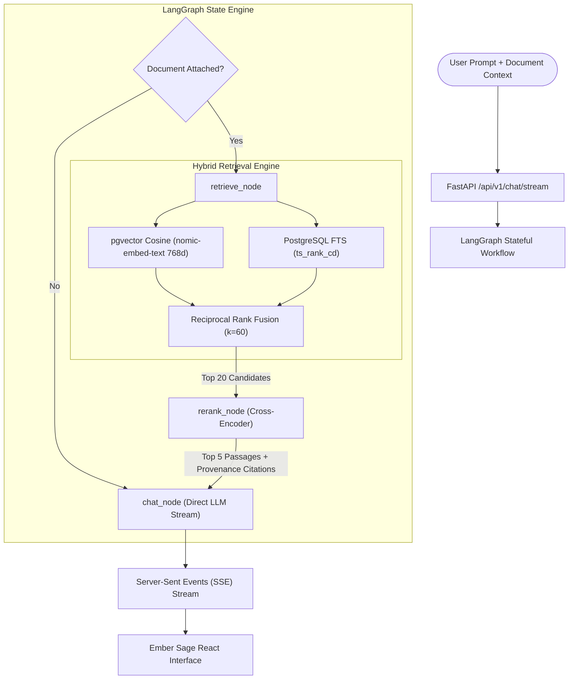

# TARK Studio — Local-First AI Workspace & Grounded Document Intelligence

> **A premium, high-performance local-first AI workspace featuring stateful LangGraph orchestration, hybrid dense-sparse RAG with pgvector and PostgreSQL FTS, INT8 cross-encoder reranking, and an editorial Ember Sage visual aesthetic.**

---

## 1. Product Vision & Overview

TARK Studio is built for developers and researchers who require:
- **Local-first privacy and speed:** Fast hybrid document retrieval and local vector storage.
- **Stateful conversation orchestration:** Powered by **LangGraph** with PostgreSQL checkpointing (`AsyncPostgresSaver`) for conversation state and branching.
- **Audited RAG & Verifiable Citations:** Parallel Dense Vector Search (Ollama `nomic-embed-text` 768d) + PostgreSQL Full-Text Search (`ts_rank_cd`), fused via Reciprocal Rank Fusion (RRF $k=60$) and reranked using an INT8 quantized cross-encoder.
- **Dark Neo-Brutalist Aesthetic:** The signature **Ember Sage** design system (copper accents, sage highlights, editorial typography, dark elevated surfaces).

---

## 2. Technology Stack

### Frontend
- **Framework:** React 19 + TypeScript + Vite
- **Styling:** Tailwind CSS (Dark Neo-Brutalist design tokens, 70/20/10 visual hierarchy)
- **Icons & Components:** Lucide React, Radix UI primitives
- **Testing:** Vitest

### Backend & Orchestration
- **Runtime & Web Framework:** Python 3.12 + FastAPI + Pydantic v2
- **AI Orchestration:** **LangGraph** state graph (`START` $\rightarrow$ `retrieve` $\rightarrow$ `rerank` $\rightarrow$ `chat` $\rightarrow$ `END`)
- **Persistence & Checkpointing:** PostgreSQL + `AsyncPostgresSaver` via `psycopg`
- **Database & ORM:** PostgreSQL 16 + `pgvector` + SQLAlchemy 2.0 (Async) + Alembic migrations
- **Embeddings:** Ollama `nomic-embed-text` (768 dimensions, cosine similarity)
- **Retrieval:** Parallel Dense Vector Search + PostgreSQL Full-Text Search (FTS `ts_rank_cd`) with Reciprocal Rank Fusion (RRF)
- **Rerankers:**
  - **ONNX (Production):** `Xenova/ms-marco-MiniLM-L-6-v2` (22 MB INT8 quantized cross-encoder via ONNX Runtime)
  - **BGE (Local Benchmarking):** `BAAI/bge-reranker-v2-m3` via FlagEmbedding
  - **Baseline:** Strict RRF ranking pass-through
- **LLM Inference:** Groq API (High-throughput streaming via Server-Sent Events / SSE)
- **Testing:** Pytest with AnyIO / AsyncIO

---

## 3. Ember Sage Design System

- **Main Background:** `#10130F`
- **Sidebar & Surface:** `#171C17`
- **Elevated Surfaces:** `#20271F`
- **Borders & Dividers:** `#394336`
- **Primary Text:** `#F1EEE6`
- **Secondary Text:** `#B7BDAE`
- **Sage Accent:** `#A5B49A` (Secondary emphasis, status indicators)
- **Ember Accent:** `#E59A64` (Primary actions, block shadows, key metrics)
- **Ember Hover:** `#F0AB78`

---

## 4. Architecture & RAG Pipeline



---

## 5. Audited Benchmark Results (40 Questions on `pythonlearn.pdf`)

Evaluated on the 241-page textbook `pythonlearn.pdf` (325 chunks):

| Metric | Baseline (Strict) | ONNX (`MiniLM-L-6-v2`) | BGE (`bge-reranker-v2-m3`) |
| :--- | :--- | :--- | :--- |
| **HitRate@5** | 97.50% | 97.50% | 97.50% |
| **HitRate@20** | 97.50% | 97.50% | 97.50% |
| **True Recall@5** | 18.75% | **20.54% (+1.79% pts)** | **21.90% (+3.15% pts)** |
| **True Recall@20 (Candidate)** | **41.82%** | **41.82% (INVARIANT)** | **41.82% (INVARIANT)** |
| **Precision@5** | 54.50% | **58.00% (+3.50% pts)** | **63.00% (+8.50% pts)** |
| **MRR@10** | 0.8175 | **0.8854 (+0.0679)** | **0.9021 (+0.0846)** |
| **nDCG@5** | 0.5848 | **0.6303 (+0.0455)** | **0.6726 (+0.0878)** |
| **Mean Reranking Latency** | 0.01 ms | **1,593.5 ms (1.59s)** | 98,374.5 ms (98.4s) |
| **Model Size on Disk** | 0 MB | **22 MB (INT8 ONNX)** | 2,240 MB (2.24 GB) |
| **Render 512MB Plan Safety** | PASS | **PASS (Optimal)** | FATAL OOM (Crash) |

---

## 6. Getting Started

### Prerequisites
- Python 3.12+
- Node.js 20+ and npm
- Docker Desktop (for PostgreSQL with `pgvector`)
- Ollama with `nomic-embed-text` (`ollama pull nomic-embed-text`)

### 1. Database Setup (Docker)
```bash
docker-compose up -d
```
*Starts PostgreSQL 16 with pgvector on port 5433.*

### 2. Backend Setup
```bash
# Navigate to backend directory
cd backend

# Create and activate virtual environment (optional)
python -m venv .venv
source .venv/bin/activate  # Windows: .venv\Scripts\activate

# Install dependencies
pip install -r requirements.txt

# Configure environment
cp ../.env.example ../.env
# Edit .env with your GROQ_API_KEY

# Run database migrations
alembic upgrade head

# Start backend server
python run.py
```
*Backend runs on `http://127.0.0.1:8000`.*

### 3. Frontend Setup
```bash
# Navigate to frontend directory
cd frontend

# Install dependencies
npm install

# Start Vite dev server
npm run dev
```
*Frontend runs on `http://localhost:5173`.*

---

## 7. Running Tests

### Backend Unit & Integration Tests (Pytest)
```bash
cd backend
pytest -v
```

### Frontend Tests (Vitest)
```bash
cd frontend
npm test -- --run
```

---

## 8. License

MIT License. See [LICENSE](LICENSE) for details.
