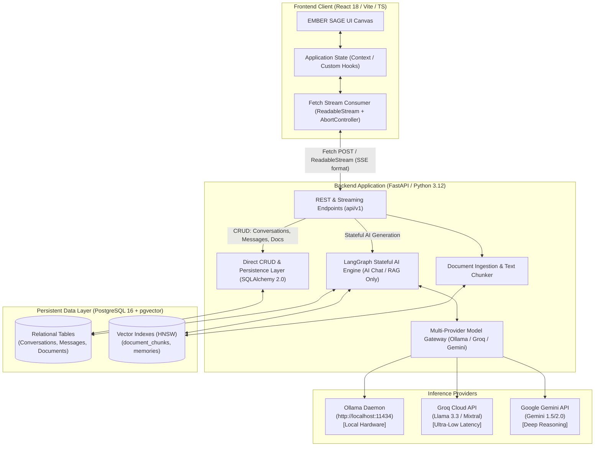

# TARK Studio — System Architecture

**Version:** 1.0.0  
**Status:** Architecture & Planning Phase (Awaiting Review)  
**Author:** TARK Engineering & Product Team  
**Design Identity:** EMBER SAGE

---

## 1. High-Level System Architecture

TARK Studio is structured as a decoupled, local-first client-server system. The frontend is a high-performance Single Page Application (SPA) built with React, Vite, TypeScript, and Tailwind CSS. The backend is an asynchronous Python service built on FastAPI, SQLAlchemy 2.0 (asyncio), LangGraph, and PostgreSQL with the `pgvector` extension.



---

## 2. Frontend Architecture

### 2.1 Technology Stack & Core Choices
- **Framework:** React 18+ with TypeScript (strict mode enabled).
- **Build Tool:** Vite (ESBuild-powered hot reload, optimized production bundling).
- **Styling:** Tailwind CSS with custom EMBER SAGE color tokens, custom CSS variables, and zero arbitrary unmanaged utility styles.
- **Icons & Typography:** Lucide React (clean, geometric glyphs), fonts imported locally or self-hosted (`Instrument Serif`, `Instrument Sans`, `IBM Plex Mono`).
- **Markdown & Code:** `react-markdown` with `remark-gfm` and syntax highlighting via `prismjs` or `shiki` wrapped in a custom neo-brutalist code block component with copy and language badge.

### 2.2 Component Hierarchy
```
AppRoot
├── ThemeProvider & ToastProvider
└── WorkspaceLayout
    ├── Sidebar (Collapsible, Neo-Brutalist 1px Border)
    │   ├── BrandHeader (Instrument Serif mark + version)
    │   ├── NewThreadButton (Ember accent highlight)
    │   ├── ThreadList (Grouped by Today, Yesterday, Previous 7 Days)
    │   │   └── ThreadItem (Title, Model badge, Delete/Archive action)
    │   ├── StorageHealthIndicator (PostgreSQL & Ollama live status)
    │   └── MemoryDrawerTrigger (Sage badge with count of retained facts)
    ├── MainChatCanvas
    │   ├── ChatHeader
    │   │   ├── ThreadTitleEditor
    │   │   ├── ModelSelector (Ollama / Groq / Gemini dropdown with provider badge)
    │   │   ├── DocumentContextPills (Attached files with token counters)
    │   │   └── ThreadActions (Clear context, export thread)
    │   ├── MessageScrollArea (Virtualized or auto-scrolling with sticky scroll-lock)
    │   │   ├── MessageBubble (User: #20271F elevated surface, right-aligned)
    │   │   ├── MessageBubble (Assistant: Transparent/Inset, left-aligned)
    │   │   │   ├── CitationTray (Sage accent pills displaying referenced document pages)
    │   │   │   ├── MemoryPills (Notice indicating which user preference influenced output)
    │   │   │   ├── MarkdownRenderer (Neo-brutalist tables, code blocks)
    │   │   │   └── GenerationMetricsBar (Mono font: TTFT 210ms | 84 t/s | llama3.3)
    │   │   └── StreamingCursor (Blinking ember indicator)
    │   └── InputDock
    │       ├── DocumentDropzoneOverlay (Drag-and-drop file attachment)
    │       ├── AttachedFilesBar (Pre-upload preview chips)
    │       ├── AutoExpandingTextarea (Shift+Enter for newline, Enter to submit)
    │       └── InputToolbar (RAG toggle, Memory toggle, Model indicator, Send/Stop button)
    └── SlideOverDrawers
        ├── DocumentLibraryDrawer (Upload, status, chunk view, delete)
        └── MemoryManagementDrawer (List active memories, edit, toggle, purge)
```

### 2.3 State Management & Fetch-Based Streaming Hook
Rather than introducing heavy Redux or MobX stores, the frontend uses targeted custom hooks and a lightweight React Context pattern:
- **`useChatStream` Hook:** Encapsulates client-initiated `fetch` with `ReadableStream` and `AbortController`. Parses the incoming SSE stream line-by-line (`data: {...}\n\n`), parses typed event payloads, and accumulates assistant message tokens in real time.
- **Explicit Cancellation & Abort:** When the user clicks Stop or unmounts the active chat view, `abortController.abort()` immediately fires, severing the HTTP stream. The backend request reader detects the cancellation and terminates model inference immediately.
- **Resilience & Reconnection:** Reconnection is handled explicitly in application logic: if the stream terminates prematurely with network interruption, the client retries with an explicit `last_sequence_id` or requests regeneration, rather than assuming browser-native `EventSource` behavior (which does not support POST bodies).
- **Duplicate Prevention:** The client disables the submission dock while a response stream is active (`is_generating: true`) and generates an idempotent client turn ID to prevent duplicate requests.
- **Backpressure & Virtualization:** Rendering state is debounced using `requestAnimationFrame` during high-frequency token bursts (such as Groq generating at >150 tokens/second), preventing DOM thrashing.

---

## 3. Backend Architecture

### 3.1 Framework & Core Modules
The backend is built with **FastAPI** using an asynchronous application layout:
```
backend/
├── app/
│   ├── main.py                  # FastAPI instantiation, lifespan, CORS, middleware
│   ├── config.py                # Pydantic BaseSettings (env validation)
│   ├── api/                     # API routes grouped by version
│   │   └── v1/
│   │       ├── router.py        # Top-level API router aggregator
│   │       ├── conversations.py # Thread CRUD
│   │       ├── messages.py      # Chat message dispatch and SSE streaming
│   │       ├── models.py        # Model list and provider health checks
│   │       ├── documents.py     # Document upload, chunking, and management
│   │       └── memories.py      # Memory inspection, edit, delete
│   ├── core/                    # Core infrastructural utilities
│   │   ├── errors.py            # Custom exception classes and handlers
│   │   ├── security.py          # Input sanitation, path traversal guards
│   │   └── events.py            # SSE event formatting helpers
│   ├── db/                      # Database connection and session management
│   │   ├── session.py           # Async engine and async_sessionmaker
│   │   └── base.py              # Base declarative model class
│   ├── models/                  # SQLAlchemy ORM model definitions
│   │   ├── conversation.py
│   │   ├── message.py
│   │   ├── document.py
│   │   ├── chunk.py
│   │   └── memory.py
│   ├── schemas/                 # Pydantic v2 validation models (DTOs)
│   │   ├── conversation.py
│   │   ├── message.py
│   │   ├── model.py
│   │   ├── document.py
│   │   └── memory.py
│   ├── services/                # Business logic layer
│   │   ├── conversation_service.py
│   │   ├── document_service.py
│   │   ├── memory_service.py
│   │   └── ingestion_service.py
│   └── ai/                      # AI orchestration and model adapters
│       ├── providers/
│       │   ├── base.py          # BaseLLMProvider abstract interface
│       │   ├── ollama.py        # Ollama local HTTP implementation
│       │   ├── groq.py          # Groq cloud implementation
│       │   └── gemini.py        # Gemini cloud implementation
│       ├── embeddings/
│       │   ├── base.py          # BaseEmbeddingProvider interface
│       │   └── provider.py      # Embedding generator (Ollama or Cloud)
│       └── workflows/
│           ├── state.py         # LangGraph state definitions
│           └── chat_workflow.py # LangGraph graph compiled execution pipeline
```

### 3.2 Asynchronous Database Management
- **SQLAlchemy 2.0 Async:** Uses `asyncpg` as the underlying async driver for PostgreSQL.
- **Connection Pooling:** `create_async_engine` configured with `pool_size=10`, `max_overflow=20`, `pool_recycle=1800`, and `pool_pre_ping=True`.
- **Session Dependency:** Yielded per-request via FastAPI's dependency injection (`Depends(get_db)`), ensuring transaction isolation and automatic rollback on unhandled exceptions.

---

## 4. AI Orchestration with LangGraph

### 4.1 Strict Boundary: Orchestration vs. CRUD
LangGraph is used **strictly for stateful multi-step AI orchestration** (retrieval-augmented generation, prompt composition, provider streaming, and post-generation memory extraction). 

Standard database operations (fetching thread history, editing titles, archiving conversations, deleting documents, and direct CRUD) are executed directly via SQLAlchemy 2.0 async service layers **outside** LangGraph to prevent unnecessary overhead, cognitive complexity, and abstraction bloat.

### 4.1 Graph Topology & Node Workflow
```mermaid
flowchart TD
    Start([User Dispatches Message]) --> LoadState[Node: Load Conversation & State]
    LoadState --> RouteChecks{Document Attached\nor RAG Enabled?}
    
    RouteChecks -- Yes --> RetrieveDocs[Node: Retrieve Document Chunks\n(pgvector HNSW Cosine Similarity)]
    RouteChecks -- No --> RetrieveMemory[Node: Retrieve Relevant Memories\n(pgvector Semantic Search)]
    
    RetrieveDocs --> RetrieveMemory
    RetrieveMemory --> FormatPrompt[Node: Compose Prompt\n(System + Memory + Bounded Chunks + History)]
    FormatPrompt --> StreamInference[Node: Stream LLM Generation\n(Ollama / Groq / Gemini)]
    StreamInference --> CheckMemoryExtraction{Extract New\nMemories?}
    
    CheckMemoryExtraction -- Yes --> ExtractMemory[Node: Extract & Vectorize Memory\n(Background Async Task)]
    CheckMemoryExtraction -- No --> End([Complete Stream])
    ExtractMemory --> End
```

### 4.2 State Schema (`ChatState`)
The LangGraph state is strictly typed using Python `TypedDict` / Pydantic:
```python
class ChatState(TypedDict):
    conversation_id: UUID
    message_id: UUID
    provider: str               # "ollama" | "groq" | "gemini"
    model_name: str
    user_query: str
    system_prompt: str
    history_messages: list[dict] # Prior turns
    retrieved_chunks: list[dict] # Chunks from pgvector
    active_memories: list[dict]  # Relevant memory facts
    assembled_prompt: list[dict] # Final message list sent to provider
    stream_generator: Any        # Async iterator yielding token deltas
    generated_text: str          # Final accumulated output
    prompt_tokens: int
    completion_tokens: int
    error: Optional[str]
```

### 4.3 Node Responsibilities
1. **`RetrieveDocsNode`:** Queries `document_chunks` for the top-k (e.g. k=4) highest cosine similarity embeddings matching the user's query vector within the conversation's attached documents.
2. **`RetrieveMemoryNode`:** Queries active `memories` for user preferences and structural guidelines semantically matching the query.
3. **`FormatPromptNode`:** Enforces strict boundary tags. Retrieved context is injected into the system prompt:
   ```markdown
   <retrieved_context>
     <chunk document="api_spec.md" index="3">
       ...content...
     </chunk>
   </retrieved_context>
   ```
4. **`StreamInferenceNode`:** Invokes the unified provider streaming interface, yielding tokens back through an `asyncio.Queue` connected directly to the FastAPI SSE response.
5. **`ExtractMemoryNode`:** Evaluates the conversation exchange asynchronously. If a durable preference or technical constraint is identified (confidence > 0.8), it is vectorized and inserted into `memories`.

---

## 5. Model Provider Abstraction

### 5.1 Unified Provider Interface
To prevent vendor lock-in and ensure clean testability, all inference providers adhere to a common abstract base class:

```python
class BaseLLMProvider(ABC):
    @abstractmethod
    async def stream_chat(
        self,
        messages: list[ChatMessage],
        model: str,
        temperature: float = 0.7,
        max_tokens: Optional[int] = None,
    ) -> AsyncIterator[StreamChunk]:
        """Stream token chunks and metadata from the provider."""
        pass

    @abstractmethod
    async def list_models(self) -> list[ModelDescriptor]:
        """Query available models supported by this provider."""
        pass

    @abstractmethod
    async def health_check(self) -> ProviderHealth:
        """Validate connectivity and authentication."""
        pass
```

### 5.2 Provider Implementations
1. **`OllamaProvider`:**
   - Communicates with the local Ollama daemon (`http://localhost:11434/api/chat`).
   - Zero external network calls.
   - Dynamic health checks query `/api/tags` to list installed models and compute local VRAM/RAM readiness.
2. **`GroqProvider`:**
   - High-throughput, ultra-low latency inference using the official Groq client or OpenAI-compatible endpoint with custom API key headers.
   - Ideal for coding and rapid prototyping.
3. **`GeminiProvider`:**
   - Deep reasoning, high context window capability using the Google Generative AI SDK (`google-genai`).
   - Optimized for large document synthesis and multi-file analysis.

### 5.3 Privacy Guard & Routing Enforcement
The provider factory implements an active privacy check:
```python
def resolve_provider(conversation: Conversation, requested_provider: str) -> BaseLLMProvider:
    if conversation.is_local_only and requested_provider != "ollama":
        raise PrivacyViolationError(
            f"Thread '{conversation.id}' is designated as Local-Only. "
            f"Dispatching to cloud provider '{requested_provider}' is strictly forbidden."
        )
    return get_registered_provider(requested_provider)
```

---

## 6. Streaming Architecture (Fetch + SSE)

FastAPI serves streams via `StreamingResponse(media_type="text/event-stream")` in response to client `POST /api/v1/conversations/{id}/messages` requests.

### 6.1 Event Wire Protocol
Each SSE packet follows the standard `event: <name>\ndata: <json>\n\n` specification:

```
event: meta
data: {"sequence_id": 1, "message_id": "c138fd94-f201-4475-a08e-173693247063", "conversation_id": "9b1deb4d-3b7d-4bad-9bdd-2b0d7b3dcb6d", "model": "llama3.2", "provider": "ollama"}

event: citation
data: {"sequence_id": 2, "document_id": "4a12...", "chunk_id": "8f31...", "source": "ARCHITECTURE.md", "score": 0.89}

event: memory_applied
data: {"sequence_id": 3, "id": "1c33...", "content": "Prefers async SQLAlchemy 2.0 without lazy loading"}

event: token
data: {"sequence_id": 4, "delta": "To"}

event: token
data: {"sequence_id": 5, "delta": " implement"}

event: meta
data: {"sequence_id": 6, "prompt_tokens": 142, "completion_tokens": 85, "ttft_ms": 185, "total_duration_ms": 1120}

event: done
data: {"sequence_id": 7, "finish_reason": "stop"}
```

### 6.2 Connection Lifecycle, Cancellation & Disconnect Safety
1. **Client Dispatch:** Client initiates request via `fetch(url, { method: "POST", body: JSON.stringify(...), signal: abortController.signal })` and consumes chunks with `response.body.getReader()`.
2. **Explicit Cancellation Propagation:** When the user clicks **Stop**, `abortController.abort()` fires. The client HTTP socket closes immediately.
3. **Backend Cancellation Detection:** FastAPI's async generator listens to `await request.is_disconnected()`. If disconnected:
   - Upstream LLM streaming iteration is cancelled immediately.
   - Any in-progress LangGraph execution task is cancelled via `asyncio.Task.cancel()`.
   - Partial messages are marked with `finish_reason = "abort"` or cleaned up according to persistence rules.
4. **Resilience & Explicit Reconnect:** Since browser-native `EventSource` cannot perform POST requests, the frontend stream reader explicitly implements reconnect semantics:
   - Tracks received `sequence_id` integers.
   - If a connection is severed before `event: done`, the UI flags the message as interrupted and surfaces a "Resume / Retry" action rather than silently duplicating generation.
5. **Duplicate Request Guard:** Backend enforces an in-flight check per `conversation_id`, preventing concurrent message dispatches to the same thread while inference is active.

---

## 7. Memory and RAG Subsystem Design

### 7.1 Memory Pipeline
- **Milestone Deferral:** Full memory extraction implementation is deferred to the dedicated Memory milestone.
- **Architectural Design:**
  - Memory extraction will be designed as an **asynchronous, idempotent, and retryable** background operation.
  - Avoid premature message broker or external queue dependencies (no Celery, no Redis). It will execute via lightweight background tasks / FastAPI `BackgroundTasks` within the existing async event loop.
  - Memories are persisted to PostgreSQL `memories` table with 768-dimensional embeddings and retrieved via pgvector HNSW cosine search.

### 7.2 RAG Ingestion & Candidate Embedding Model
- **Initial Candidate Embedding Model:** Ollama `nomic-embed-text` (768 dimensions).
  - *Constraint:* The embedding model is neither downloaded nor loaded during initial milestones; zero quality benchmarks are fabricated until empirical evaluations are executed.
- **Initial Supported Formats:** PDF (`.pdf`), Markdown (`.md`), Plain Text (`.txt`), Python (`.py`), and JSON (`.json`). Formats like DOCX and XLSX are strictly excluded from the initial scope.
- **RAG Ingestion Flow:**
```
[User Document: PDF / MD / TXT / PY / JSON]
          │
          ▼
   File Validator (MIME, 25MB Limit, SHA-256 Hash)
          │
          ▼
   Text Extractor (pypdf for PDF, native text readers for MD/TXT/PY/JSON)
          │
          ▼
   Recursive Character Splitter (512 tokens, 64 overlap)
          │
          ▼
   Embedding Generator (nomic-embed-text, 768 dims)
          │
          ▼
   PostgreSQL `document_chunks` (pgvector HNSW index)
```

- **Query Execution:**
  ```sql
  SELECT chunk_id, document_id, content, 
         1 - (embedding <=> :query_embedding) AS similarity
  FROM document_chunks
  WHERE document_id = ANY(:allowed_document_ids)
    AND 1 - (embedding <=> :query_embedding) >= :similarity_threshold
  ORDER BY embedding <=> :query_embedding ASC
  LIMIT :top_k;
  ```
- **Prompt Injection Defense:** Retrieved chunks are stripped of dangerous formatting, enclosed in strict `<untrusted_retrieved_context>` tags, and the system prompt explicitly commands the model to ignore instructions found within retrieved text.
