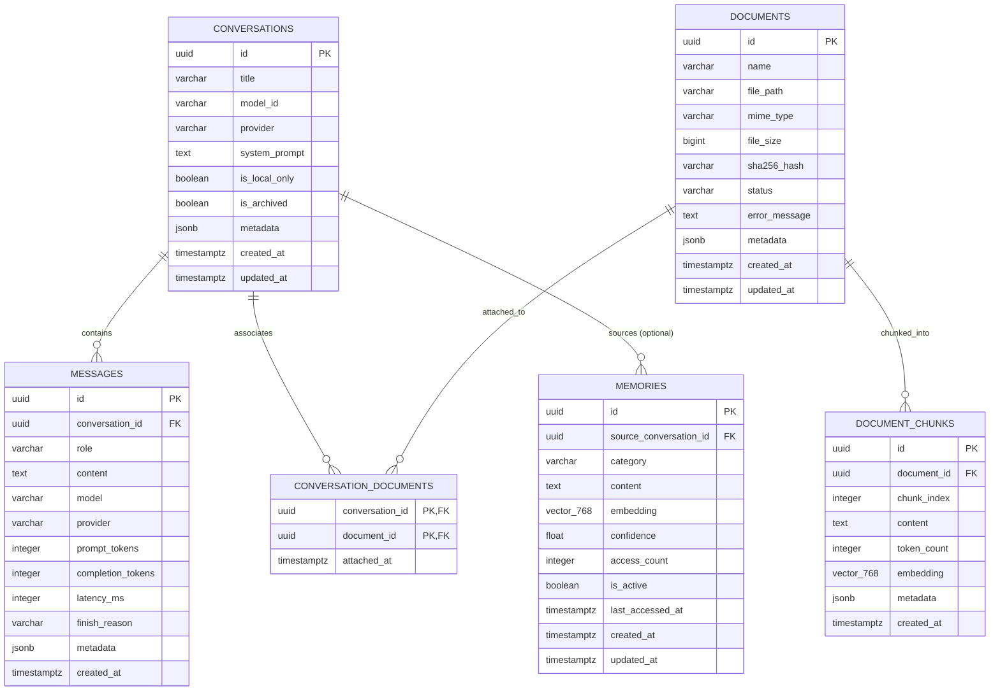

# TARK Studio — Database Design & Schema Specification

**Version:** 1.0.0  
**Status:** Architecture & Planning Phase (Awaiting Review)  
**Database Engine:** PostgreSQL 16+ with `pgvector` Extension  
**ORM:** SQLAlchemy 2.0 (Asyncio)  
**Migrations:** Alembic

---

## 1. Overview & Vector Configuration

TARK Studio uses PostgreSQL as its unified relational and vector data store. By pairing standard relational tables with the `pgvector` extension, the architecture avoids the complexity and operational overhead of running a separate vector database (such as Pinecone, Qdrant, or Chroma).

### 1.1 Vector Extension Activation & Environment Configuration
- **Containerization:** PostgreSQL 16 is run via Docker Compose using the official `pgvector/pgvector:pg16` image with a named persistent volume (`tark_postgres_data`) and an integrated `pg_isready` healthcheck.
- **Environment Driven:** Connection URLs are strictly configured via environment variables (`DATABASE_URL=postgresql+asyncpg://${POSTGRES_USER}:${POSTGRES_PASSWORD}@${POSTGRES_HOST}:${POSTGRES_PORT}/${POSTGRES_DB}`). Default credentials and secrets are never committed or hardcoded.
- **Migration Managed:** The `vector` and `uuid-ossp` extensions are enabled deterministically through Alembic migration scripts, ensuring zero manual database setup steps:
```sql
-- Managed in Alembic Migration 0001
CREATE EXTENSION IF NOT EXISTS "uuid-ossp";
CREATE EXTENSION IF NOT EXISTS "vector";
```

### 1.2 Vector Dimension Strategy
- **Standardized Dimension:** 768 dimensions (aligned with the initial candidate model Ollama `nomic-embed-text`).
- **Metric:** Cosine distance (`<=>` operator) using HNSW (Hierarchical Navigable Small World) index for fast approximate nearest neighbor search.
- **Model Ingestion Rule:** The model will not be loaded or evaluated until the RAG milestone, and retrieval performance claims will be empirically benchmarked rather than assumed.

---

## 2. Entity-Relationship Diagram (ERD)



---

## 3. Detailed Table Specifications

### 3.1 `conversations` Table
Stores conversational threads and execution defaults.

```sql
CREATE TABLE conversations (
    id UUID PRIMARY KEY DEFAULT gen_random_uuid(),
    title VARCHAR(255) NOT NULL DEFAULT 'New Conversation',
    model_id VARCHAR(100) NOT NULL,
    provider VARCHAR(50) NOT NULL, -- 'ollama', 'groq', 'gemini'
    system_prompt TEXT,
    is_local_only BOOLEAN NOT NULL DEFAULT FALSE,
    is_archived BOOLEAN NOT NULL DEFAULT FALSE,
    metadata JSONB NOT NULL DEFAULT '{}'::jsonb,
    created_at TIMESTAMPTZ NOT NULL DEFAULT CURRENT_TIMESTAMP,
    updated_at TIMESTAMPTZ NOT NULL DEFAULT CURRENT_TIMESTAMP
);

-- Indexes
CREATE INDEX idx_conversations_updated_at ON conversations(updated_at DESC);
CREATE INDEX idx_conversations_is_archived ON conversations(is_archived);
CREATE INDEX idx_conversations_provider ON conversations(provider);
```

### 3.2 `messages` Table
Maintains ordered chat history and telemetry per message.

```sql
CREATE TABLE messages (
    id UUID PRIMARY KEY DEFAULT gen_random_uuid(),
    conversation_id UUID NOT NULL REFERENCES conversations(id) ON DELETE CASCADE,
    role VARCHAR(20) NOT NULL CHECK (role IN ('user', 'assistant', 'system')),
    content TEXT NOT NULL,
    model VARCHAR(100),
    provider VARCHAR(50),
    prompt_tokens INTEGER,
    completion_tokens INTEGER,
    latency_ms INTEGER,
    finish_reason VARCHAR(50), -- 'stop', 'length', 'abort', 'error'
    metadata JSONB NOT NULL DEFAULT '{}'::jsonb, -- holds citations, applied memories, ttft
    created_at TIMESTAMPTZ NOT NULL DEFAULT CURRENT_TIMESTAMP
);

-- Indexes
CREATE INDEX idx_messages_conversation_created ON messages(conversation_id, created_at ASC);
CREATE INDEX idx_messages_role ON messages(role);
```

### 3.3 `documents` Table
Tracks uploaded files, metadata, and ingestion processing state.

```sql
CREATE TABLE documents (
    id UUID PRIMARY KEY DEFAULT gen_random_uuid(),
    name VARCHAR(255) NOT NULL,
    file_path VARCHAR(512) NOT NULL,
    mime_type VARCHAR(100) NOT NULL,
    file_size BIGINT NOT NULL,
    sha256_hash VARCHAR(64) NOT NULL,
    status VARCHAR(30) NOT NULL DEFAULT 'pending' 
        CHECK (status IN ('pending', 'processing', 'indexed', 'failed')),
    error_message TEXT,
    metadata JSONB NOT NULL DEFAULT '{}'::jsonb, -- total_chunks, page_count, author
    created_at TIMESTAMPTZ NOT NULL DEFAULT CURRENT_TIMESTAMP,
    updated_at TIMESTAMPTZ NOT NULL DEFAULT CURRENT_TIMESTAMP
);

-- Indexes & Constraints
CREATE INDEX idx_documents_status ON documents(status);
CREATE INDEX idx_documents_sha256 ON documents(sha256_hash);
CREATE INDEX idx_documents_created_at ON documents(created_at DESC);
```

### 3.4 `document_chunks` Table
Holds chunked text snippets and their dense vector embeddings.

```sql
CREATE TABLE document_chunks (
    id UUID PRIMARY KEY DEFAULT gen_random_uuid(),
    document_id UUID NOT NULL REFERENCES documents(id) ON DELETE CASCADE,
    chunk_index INTEGER NOT NULL,
    content TEXT NOT NULL,
    token_count INTEGER NOT NULL,
    embedding VECTOR(768) NOT NULL,
    metadata JSONB NOT NULL DEFAULT '{}'::jsonb, -- page_number, section_header, char_offsets
    created_at TIMESTAMPTZ NOT NULL DEFAULT CURRENT_TIMESTAMP,
    
    CONSTRAINT uq_document_chunk_index UNIQUE (document_id, chunk_index)
);

-- B-Tree and Vector Indexes
CREATE INDEX idx_document_chunks_doc_id ON document_chunks(document_id);

-- HNSW Vector Index for Fast Cosine Distance Search
CREATE INDEX idx_document_chunks_embedding_hnsw 
ON document_chunks 
USING hnsw (embedding vector_cosine_ops)
WITH (m = 16, ef_construction = 64);
```

### 3.5 `conversation_documents` Junction Table
Maps documents to specific conversations for scoped RAG context.

```sql
CREATE TABLE conversation_documents (
    conversation_id UUID NOT NULL REFERENCES conversations(id) ON DELETE CASCADE,
    document_id UUID NOT NULL REFERENCES documents(id) ON DELETE CASCADE,
    attached_at TIMESTAMPTZ NOT NULL DEFAULT CURRENT_TIMESTAMP,
    
    PRIMARY KEY (conversation_id, document_id)
);

CREATE INDEX idx_conv_docs_doc_id ON conversation_documents(document_id);
```

### 3.6 `memories` Table
Maintains durable user facts, preferences, and guidelines across sessions.

```sql
CREATE TABLE memories (
    id UUID PRIMARY KEY DEFAULT gen_random_uuid(),
    source_conversation_id UUID REFERENCES conversations(id) ON DELETE SET NULL,
    category VARCHAR(50) NOT NULL DEFAULT 'preference' 
        CHECK (category IN ('preference', 'fact', 'constraint', 'instruction')),
    content TEXT NOT NULL,
    embedding VECTOR(768) NOT NULL,
    confidence REAL NOT NULL DEFAULT 1.0,
    access_count INTEGER NOT NULL DEFAULT 0,
    is_active BOOLEAN NOT NULL DEFAULT TRUE,
    last_accessed_at TIMESTAMPTZ,
    created_at TIMESTAMPTZ NOT NULL DEFAULT CURRENT_TIMESTAMP,
    updated_at TIMESTAMPTZ NOT NULL DEFAULT CURRENT_TIMESTAMP
);

-- Indexes
CREATE INDEX idx_memories_is_active ON memories(is_active);
CREATE INDEX idx_memories_category ON memories(category);
CREATE INDEX idx_memories_last_accessed ON memories(last_accessed_at DESC);

-- HNSW Vector Index for Semantic Memory Retrieval
CREATE INDEX idx_memories_embedding_hnsw 
ON memories 
USING hnsw (embedding vector_cosine_ops)
WITH (m = 16, ef_construction = 64);
```

---

## 4. Constraints, Integrity & Cascade Policies

| Relationship | Foreign Key | Cascade Policy | Architectural Justification |
| :--- | :--- | :--- | :--- |
| `messages` $\rightarrow$ `conversations` | `conversation_id` | `ON DELETE CASCADE` | Deleting a conversation must cleanly remove all its messages. |
| `document_chunks` $\rightarrow$ `documents` | `document_id` | `ON DELETE CASCADE` | When a source document is purged, all associated vector chunks must be removed immediately to free disk and index memory. |
| `conversation_documents` $\rightarrow$ `conversations` | `conversation_id` | `ON DELETE CASCADE` | Detaches document associations if a conversation is purged. |
| `conversation_documents` $\rightarrow$ `documents` | `document_id` | `ON DELETE CASCADE` | Removes junction mapping if the underlying document is deleted. |
| `memories` $\rightarrow$ `conversations` | `source_conversation_id` | `ON DELETE SET NULL` | Memories are cross-session knowledge. Deleting the original thread where a memory was formed must **not** delete the user preference or fact. |

---

## 5. Migration Strategy with Alembic

Database migrations are strictly version-controlled using Alembic configured for async SQLAlchemy:

1. **`alembic/env.py` Integration:** Uses `async_engine_from_config` with target metadata pointing to `Base.metadata`.
2. **Deterministic Migration Sequencing:**
   - `0001_initial_extensions.py`: Creates `uuid-ossp` and `vector` extensions.
   - `0002_create_conversations_and_messages.py`: Initializes core chat storage and indexes.
   - `0003_create_documents_and_chunks.py`: Sets up document metadata and vector chunks with HNSW index.
   - `0004_create_memories_and_junctions.py`: Adds semantic memory table and conversation document associations.
3. **Safety Guidelines:**
   - Every migration must implement both `upgrade()` and `downgrade()` methods.
   - Production migrations must run transactional DDL (`op.create_table`, etc.) within an isolated revision block.
